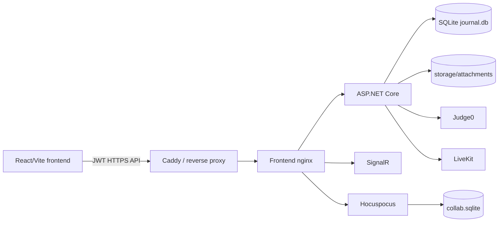
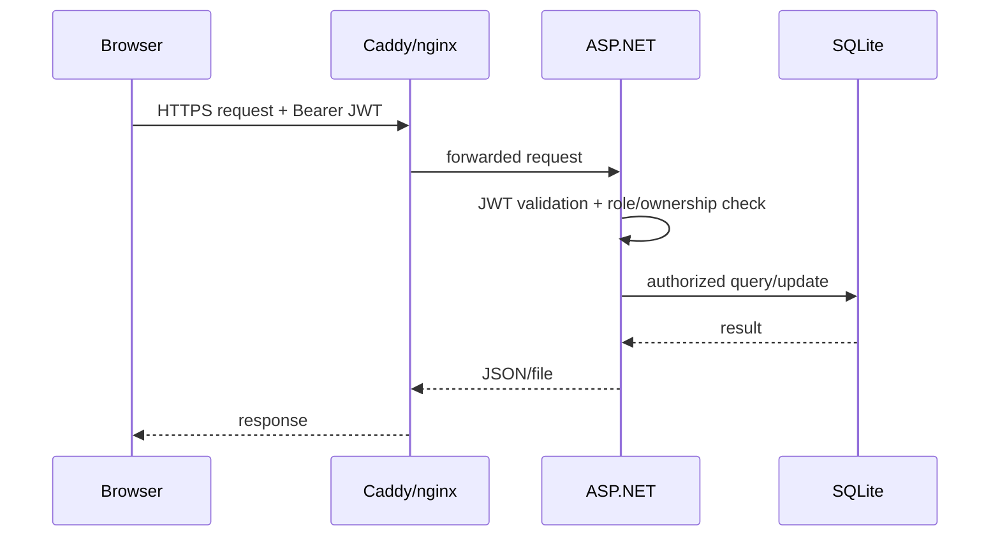

# Architecture

## Components

## Runtime boundaries

- ASP.NET Core owns domain authorization, database access, audit and external-service token issuance.
- User code is queued and executed by Judge0, not inside the ASP.NET process.
- Hocuspocus owns Yjs persistence for collaborative documents/boards.
- LiveKit owns media transport; ASP.NET issues room tokens.
- Caddy is the production public HTTPS boundary.

## Request flow

## Design rule

A feature is considered implemented only when UI → API → backend → persistence/external service forms a working path. UI-only placeholders are not considered production functionality.
