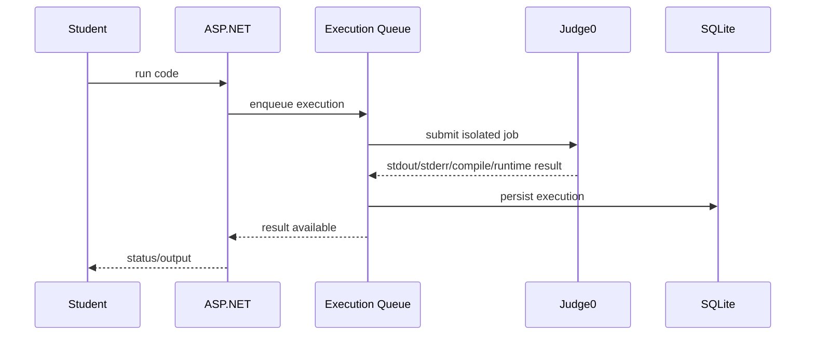

# Code Lab

## Flow

## Editor

- Monaco editor.
- Multi-file code model.
- Yjs/Hocuspocus collaboration.
- Submission versions.
- Teacher review.

## Execution safety

User code is not executed in the ASP.NET process. The configured execution policy includes CPU/wall-time, memory and output limits; network access is disabled by the application execution settings.

## External dependency

Judge0 is not bundled into the Compose stack. Set `JUDGE0_URL` to a reachable Judge0 service before claiming end-to-end code execution is operational.
