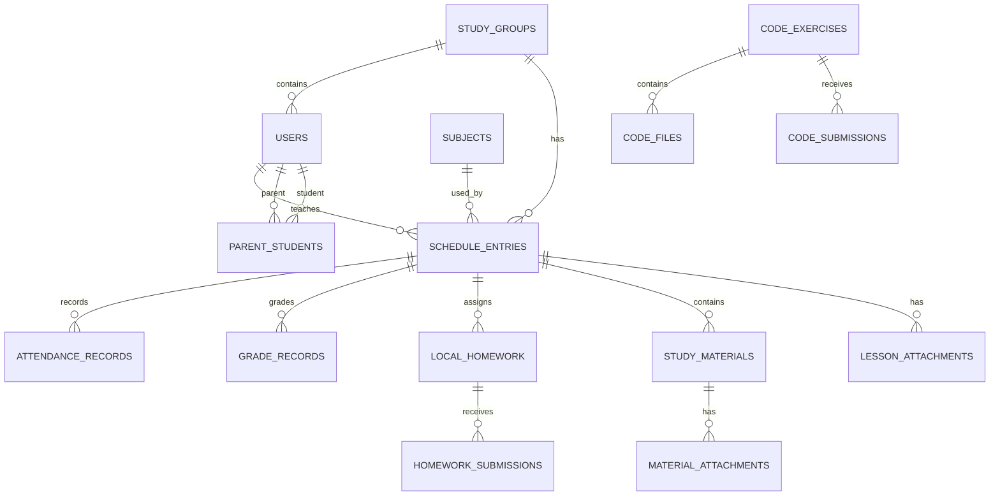

# Database

Jornal uses SQLite through Entity Framework Core.

## Main entities

The exact EF model is defined in `backend/JournalBackend/Database/AppDbContext.cs`.

## Realtime state

Hocuspocus uses a separate SQLite database, `collab.sqlite`, stored in the `collab_data` volume. It is not part of `journal.db` and is included separately in P28+ backups when available.
