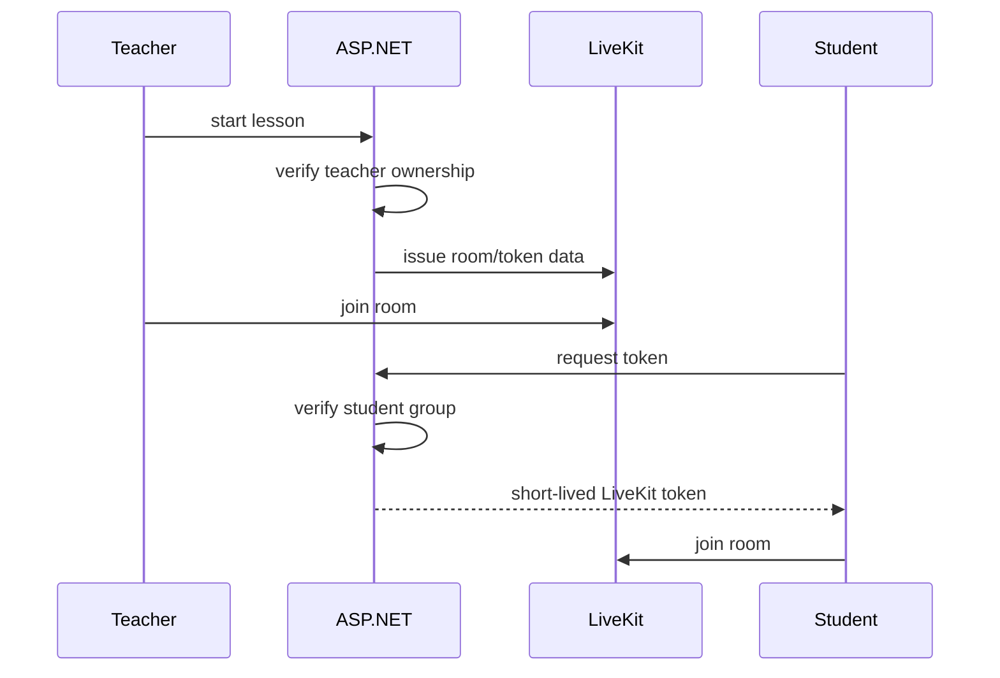

# Online lessons

LiveKit is used for media transport.

## Flow

The server controls room start/end and issues tokens with teacher/admin privileges only for teacher/admin identities. Students are limited to the lesson group.

Required environment: `LIVEKIT_URL`, `LIVEKIT_API_KEY`, `LIVEKIT_API_SECRET` and optional `LIVEKIT_TOKEN_TTL_SECONDS`.
